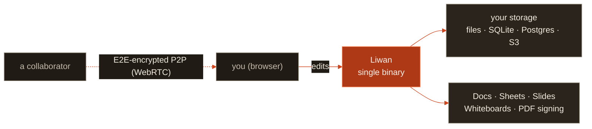
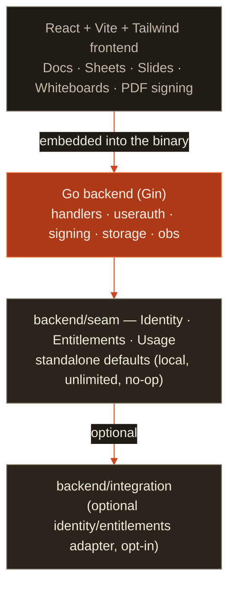

<div align="center">


# Liwan

[](https://github.com/GreenChennai/liwan/actions/workflows/ci.yml)
[](https://github.com/GreenChennai/liwan/releases)
[](LICENSE-MIT)
[](go.mod)
[](web/package.json)

### 一款真正可自托管、由你完全掌控的协作办公套件。

文档、电子表格、幻灯片和白板——**原生 CRDT** 且**实时**，以单一二进制文件交付，
运行在**你自己的存储**上。无需云账号，无遥测，无厂商锁定。

**[更新日志](CHANGELOG.md) · [MIT OR Apache-2.0](LICENSE-MIT) · [可自托管，单一二进制文件](docs/SELFHOST.md) · [CRDT，实时 P2P](docs/COLLABORATION.md) · Go 1.25 · React 18**

[**快速开始**](#快速开始) · [**文档**](docs/) · [**协作**](docs/COLLABORATION.md) · [**架构**](docs/ARCHITECTURE.md) · [**自托管**](docs/SELFHOST.md)

<br/>


</div>

---

## 什么是 Liwan？

Liwan 议事厅是一款**独立的、可自托管的办公套件**——文档、电子表格、幻灯片和白板集成在一个简洁现代的
Web 应用中，以**单一 Go 二进制文件**交付，其中已嵌入完整的前端。无需创建云账号，
不会向外部回传任何数据，你的文件保存在**你自己的存储**中。

实时协同编辑采用**点对点且原生 CRDT** 的方式：不存在中心化的文档服务器。各端通过端到端加密通道直接同步；
由于编辑是无冲突的（CRDT），所有人无需中间的权威节点即可收敛到一致状态。你运行的，就是你拥有的。

它承接了 **LibreOffice** 和 **OpenOffice** 点燃的火炬——这两个项目证明了生产力软件可以免费、开放并由社区驱动——
将其带入浏览器，基于高性能的 React 前端和轻量级的 Go 后端。



> *liwan 曾是一种登记簿，也是成册的工作档案。这一个，属于你。*

<sub>徽标取自 **iwan**——波斯与奥斯曼建筑中核心处的拱形门廊，穿过它才能到达存放登记簿的房间。
顺时针旋转四分之一圈，它就变成了 **D**：拱门的两条腿是竖杠，青绿色的门槛即为竖干。</sub>

---

## 功能特性

| | |
|---|---|
| 📝 **文档** | 富文本编辑（TipTap）——标题、表格、行内图片、脚注、任务列表、链接；锚定式**评论**、**修订建议**（带接受/拒绝的修订追踪）、可恢复的**版本历史**、查找替换、实时大纲与字数统计。 |
| 📊 **电子表格** | 完整网格（Fortune Sheet）——公式、数字格式、条件格式、**数据验证**、**图表**、**筛选**、**数据透视表**、**命名区域**、冻结窗格。 |
| 🖼️ **幻灯片** | 从零构建的定位对象画布——文本、形状和图片可自由拖动、缩放、旋转；逐元素**动画**、**主题**、可编辑的**母版幻灯片**、逐页**切换效果**，以及**演示者视图**（备注 + 计时器）。 |
| 🎨 **白板** | 基于 MIT 许可的 [Excalidraw](https://github.com/excalidraw/excalidraw) 编辑器构建的无限手绘画布——形状、箭头、自由绘制、文本和图片。场景是一个 **Yjs CRDT**，通过与文档**相同的**端到端加密 P2P 引擎同步。 |
| ⚡ **实时协同编辑** | **始终点对点，无中心文档服务器。** 编辑以 CRDT 更新的形式在**端到端加密**的房间内同步；各端通过 WebRTC 直连，仅在遇到严格 NAT 时才回退到**对内容无感知的中继**。通过邀请链接分享——密钥位于 URL 片段中，永远不会到达任何服务器。 |
| 📄 **PDF 导入/导出与签名** | 导入和导出 `.docx` · `.xlsx` · `.csv` · `.pptx` · Markdown · HTML · **PDF**。可查看、批注、填写 AcroForm 字段，并**签署** PDF，包括带密码学审计轨迹的多方签署流程。 |
| 💾 **你自己的存储** | 默认使用本地文件 + SQLite；可选 **PostgreSQL**（schema `office`）用于多用户；可选 **S3 兼容**对象存储。除非你选择，否则不会为你托管任何内容。 |
| 🔓 **无厂商锁定** | 开放格式的导入与导出，MIT 许可，单一自包含二进制文件。每个编辑器也以 npm 库形式发布（`liwan` 包——`liwan/docs`、`liwan/sheets`、`liwan/slides`、`liwan/whiteboard`、`liwan/pdf`），便于你将任何组件嵌入自己的应用。 |

Liwan 在设计上**仅包含文档类功能**：文档、表格、幻灯片、白板和 PDF 签名。聊天、视频和邮件有意**不**包含在内。

---

## 截图

Liwan 采用温暖的**浅色优先**“Workshop”视觉风格——余烬色/赤陶色强调色，纸张色调的画布，页面使用 Fraunces 字体，界面框架使用 Hanken Grotesk 字体——并提供完整的深色主题（以及*跟随系统*），只需一键即可切换。

|  |  |
| :---: | :---: |
| **文档**——Fraunces 字体的“纸张”，评论与修订建议 | **电子表格**——公式、格式、图表、透视表 |
|  |  |
| **幻灯片**——母版、主题、切换效果、演示 | **白板**——基于 P2P CRDT 引擎的 Excalidraw 画布 |
|  |  |
| **文件**——你的文档、表格、幻灯片和本地云盘 | **签名**——批注并签署 PDF |
|  |  |

**浅色与深色**——每个界面都提供两种主题，浅色优先：

|  |  |
| :---: | :---: |
|  |  |

> 随时可使用 `npm run screenshots` 重新生成——它会以预置的演示数据启动应用（无需真实后端或凭据），
> 并以视网膜分辨率截取所有界面的浅色和深色版本。参见 [docs/SCREENSHOTS.md](docs/SCREENSHOTS.md)。

---

## 快速开始

Liwan **开箱即用**——无需账号、无需云服务，也无需任何外部服务。

### Docker（一行命令）

```bash
docker run -d \
  --name liwan \
  -p 8080:8080 \
  -v liwan-data:/srv/data \
  ghcr.io/greenchennai/liwan:latest
```

打开 <http://localhost:8080>。

### 从源码构建（单一二进制文件）

前置条件：[Go 1.25+](https://golang.org/dl/) 以及 [Node.js 18+](https://nodejs.org/) 和 npm。

```bash
git clone https://github.com/GreenChennai/liwan.git
cd liwan

# Install deps and build the frontend + single binary
npm install
npm run build

# Run — single-user, local storage, no auth, no cloud
./liwan
```

打开 <http://localhost:8080>。数据保存在 `./data` 和 `./uploads` 中——整个应用就在这一个文件里。
Go 模块及其构建出的二进制文件名为 `liwan`；npm 包和产品名称为 **Liwan**。

要求登录（仍然完全独立运行）：

```bash
# config.yaml → auth.enabled: true
export LIWAN_JWT_SECRET="$(openssl rand -hex 32)"
./liwan
```

### 开发

```bash
npm run dev:web   # Vite dev server (:5173) + Go API (:8080), live reload
```

打开 <http://localhost:5173>。

### 从 Vulos 应用商店安装

Liwan 也可以在 **Vulos OS** 设备上以一键应用的形式安装（`DEPLOY_MODE=os`），在那里它通过设备网关运行，
并提供限定范围的存储和单点登录。它就是**同一个二进制文件**——应用商店只是为你配置好了身份与存储。
自行托管始终是默认路径，绝非二等选择。

---

## 架构



Liwan 是一个**嵌入了完整前端的单一 Go 二进制文件**——部署只需一个文件。零配置时，它以单用户、本地存储的应用形式运行在你自己的机器上。
所有*可能*将其与外部服务绑定的部分，都位于 `backend/seam` 中的一小组 Go 接口之后；标准构建使用本地、无限制、空操作的默认实现，
并且从不导入可选的适配器。

实时协作基于 **CRDT 且始终点对点**：文档和白板以 Yjs 更新的形式同步，表格和幻灯片使用 LWW/树形 CRDT，
全部在一个端到端加密的房间内进行，其密钥从不到达任何服务器。服务器唯一的角色是**对内容无感知的对等节点发现**——
它只知道*哪些*对等节点共享一个随机房间 ID，从不接触任何内容——而**本二进制文件自身就提供这一服务**，位于 `/api/rendezvous/*`，默认开启。
因此，一台机器上运行一个 `liwan`，就足以满足两个人协作的需要：**无需 Vulos OS、无需 Pier、无需中继、无需账号，也无需任何配置**。
你*可以*改用自己的 `vulos-relayd` 进行发现（`collab.rendezvous_url` / `VULOS_RENDEZVOUS_URL`），此时它优先生效——浏览器直接与该中继通信，
Liwan 的服务器完全不参与发现路径。参见 [docs/COLLABORATION.md](docs/COLLABORATION.md) 第 3 节和 [docs/ARCHITECTURE.md](docs/ARCHITECTURE.md)。

---

## 文档

完整文档位于 **[`docs/`](docs/)** 中。

| 文档 | 说明 |
|----------|-------------|
| [入门指南](docs/GETTING-STARTED.md) | 在本地、Docker 或生产环境中运行 |
| [自托管](docs/SELFHOST.md) | 完全独立运行；可选的身份/权益对接层 |
| [协作](docs/COLLABORATION.md) | 实时 P2P CRDT 编辑的端到端工作原理 |
| [架构](docs/ARCHITECTURE.md) | 组件图与设计决策 |
| [配置](docs/CONFIGURATION.md) | 环境变量、`config.yaml`、存储、OTEL 参考 |
| [API](docs/API.md) | REST API——文件、版本、协作、签名 |
| [管理员指南](docs/ADMIN-GUIDE.md) | 部署、备份与运维服务器 |
| [部署](docs/DEPLOY.md) | Docker、单机同址部署、静态 CDN |
| [测试](docs/TESTING.md) | Vitest 单元测试 + RTL/MSW 集成测试、Playwright E2E |
| [路线图](ROADMAP.md) · [更新日志](CHANGELOG.md) | 计划与版本历史 |

---

## 开发

```bash
npm run dev:web        # Vite (:5173) + Go API (:8080)
npm test               # unit + RTL/MSW integration tests (Vitest)
npm run test:e2e       # browser E2E (Playwright, backend mocked)
npm run test:e2e:p2p   # REAL P2P: one real binary + two real browsers, no external deps
npm run build          # frontend dist/ + Go binary
npm run screenshots    # regenerate the docs/screenshots gallery

go build ./...  &&  go test ./...  &&  go vet ./...
```

> **冻结的不变量：** 纯 Go（不使用 CGO）、仅使用 JSX（绝不使用 `.tsx`），标准构建中不包含第三方 SSO 或支付锁定。
> 参见 [CONTRIBUTING.md](CONTRIBUTING.md)。

---

## 安全

Liwan 将 HTML 净化集中在一份经过审计的 DOMPurify 策略中，将 CRDT 入口视为失败即关闭（fail-closed），
以密码学方式控制只读协作者，并在启用多用户认证时强制执行每文件 ACL。发现漏洞？请**私下**报告——参见
[SECURITY.md](SECURITY.md)、[THREAT-MODEL.md](docs/THREAT-MODEL.md) 和 [SECURITY-TESTING.md](docs/SECURITY-TESTING.md)。
请勿为安全问题公开提交 Issue。

---

## 参与贡献

欢迎提交 Pull Request——尤其欢迎缺陷修复、签名健壮性改进、无障碍（accessibility）、测试和文档。
对于重大变更，请先提交 Issue。环境搭建、代码风格和冻结的不变量参见 [CONTRIBUTING.md](CONTRIBUTING.md)。无需签署 CLA。

---

## 品牌

[`brand/`](brand/) 中的标识是权威来源。本仓库发布的每一个图标——favicon、PWA 与应用图标，以及 README 和网站上的标识——
都由 `brand/logo.svg` 渲染生成，而非重新绘制，因此只有一份经批准的图稿，不会存在随下游漂移的副本。

向外复制，切勿编辑衍生副本，也切勿为了匹配下游内容而编辑 `brand/`。

## 许可证

[MIT](LICENSE-MIT) OR [Apache-2.0](LICENSE-APACHE) — © VulOS. Liwan is a VulOS
project; source and issues at [github.com/GreenChennai/liwan](https://github.com/GreenChennai/liwan).

---

<p align="center">
  <a href="https://vulos.org"></a><br>
  <sub><a href="https://vulos.org"><b>vulos</b></a> — 以开放为本</sub>
</p>
