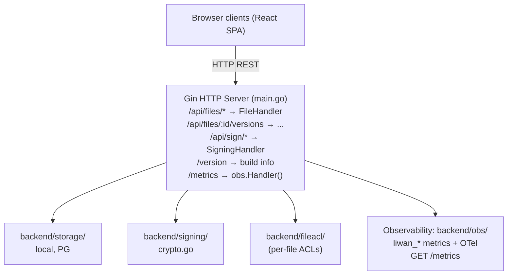

# Liwan – 架构

## 概述

Liwan 是一个协作文档编辑与电子签署服务。它对外提供：
- 带版本历史的文件增删改查（CRUD）
- REST 持久化，以及实时协作（评论、修改建议、实时共同编辑）。实时共同编辑始终通过一个端到端加密的房间进行点对点传输，并有两种 CRDT 实现，见下方说明
- 电子签署流程（信封 → 签署 → 封存 PDF）

> **范围：** Liwan 仅包含文档类应用（Docs、Sheets、Slides、Whiteboards、PDF/Signing）。日历和通讯录来自“自带邮箱”的 PIM 连接器（lilmail CalDAV/CardDAV + lilmail `/v1/calendar` + `/v1/contacts`），由操作系统以独立小组件的形式呈现。聊天和视频由第三方提供（Matrix/Element；Element Call / Jitsi），并非 Vulos 产品。Vulos OS 是承载这些应用的外壳。

> **协作传输说明：** 实时共同编辑基于 CRDT，并且**完全点对点运行——不存在中央文档服务器**。Liwan 二进制文件不托管任何操作中继、文档状态中心或服务器中转的协作端点（已在 `main.go` 的 `/v1` 路由块中确认："Office collaboration is ALWAYS peer-to-peer … deliberately NO central document server"）。代码库中有**两种 CRDT 会话实现**——一种正在使用，另一种已被取代但仍有测试覆盖——二者都运行在**同一个**端到端加密房间（`src/lib/crdt/p2pRoom.js`）之上，并使用同一个第一方 `src/lib/collab/webrtc/fabric.js` 传输层（从 vendored relay-client SDK 迁入，Liwan 不依赖任何其他 Vulos 产品的包）：
> - **Yjs 会话**（`YP2PCollabSession`，`src/lib/crdt/yP2PSession.js`）——**Docs** 使用的、可感知结构的路径。文档是一个 Yjs 文档（`src/lib/crdt/ydoc.js`），通过 y-prosemirror 与 ProseMirror 保持逐步同步；对等方交换 Yjs 更新以及状态向量重同步。白板文档类型通过 `boardYdoc.js` 中的 Excalidraw 场景校验器运行在同一会话之上。
> - **表格与树形会话**——Sheets 的 LWW 表格和 Slides 的分数索引树直接通过 `SubstrateGridSession` / `GridSession` 以及 `TreeSession` 运行在同一套传输层上，而不是通过文档会话。（此前这里还列出过第三种路径：基于手写文本 RGA 的 `P2PCollabSession`，即 `crdt/text.js` + `crdt/index.js`。当 Docs 迁移到 Yjs 后它已被取代，且此后没有编辑器再构造它，因此约 1,040 行代码已被删除，而不是留着让人误以为仍是可用模式。）
> - 两种情况下，对等方都通过 WebRTC 数据通道**直接**相连（借助 STUN）；只有在遇到硬 NAT 时才会回退到**内容盲中继**电路（每个会话使用 X25519 box——只传输密文）。帧使用 AES-256-GCM 加密，密钥由 HKDF 从房间密钥派生，房间密钥携带在 URL **片段**（`#vp2p=…`）中，片段永远不会发送到任何服务器。
> - **在线状态**（光标 + 成员列表）运行在**同一个端到端加密房间**中，因此主机永远不知道谁在房间里；在线状态是临时的，从不持久化。只读对等方持有解密密钥，但没有读写权限的 MAC 密钥，因此其写入在密码学上会被拒绝。
> - **服务器唯一的角色**是内容盲的对等方**发现**（信令 + ICE），按四选一的顺序解析（`src/lib/collab/transportSelection.js`，见 docs/COLLABORATION.md §3）：(1) 本服务器自身的 `/api/peering/*`，由部署在 Liwan 前面的主机（Vulos OS / Pier）提供；否则 (2) 配置的会合（rendezvous）URL（`config.yaml` 中的 `collab.rendezvous_url` / `VULOS_RENDEZVOUS_URL`），指向任意自托管 `vulos-relayd` 的开放会合接口；否则 (3) **本二进制文件自带的接口**，位于 `/api/rendezvous/*`（`backend/rendezvous`，`collab.builtin_rendezvous`，**默认开启**）——正是它使得单独运行的 Liwan 二进制文件无需部署其他任何产品、无需任何配置即可实现真正的点对点协作；否则 (4) 没有任何可达的发现方式，协作保持**仅本地**并自动保存，UI 如实显示“离线”。
> - 自带接口采用**签名认证**（基于带域分隔的规范消息的 Ed25519 签名），具有 nonce 与时间戳以防重放，各维度均有上限，按 IP 限速，并且仅在内存中保存软状态，TTL 为分钟级。它只传输不透明字节：房间密钥位于邀请链接的 URL 片段中，且不会到达任何服务器。其线路格式与 relayd 逐字节一致，并且 Go 与 JS 两种实现的签名规范消息被固定在共享的测试向量上，以防二者出现偏差。
>
> 入口校验采用**失败即关闭（fail-closed）**策略：每个不可信的更新在触及实时文档之前，都会先在影子文档上试应用，针对真实 schema 进行转换，并进行图片/链接的范围钳制（格式错误、超大或无法渲染的更新会被丢弃，绝不抛出异常）。

## 组件图

## 关键设计决策

- **Gin 框架**：因其中间件生态以及现有代码库而选用。
- **客户端 CRDT 模块**（`src/lib/crdt/`）：所有合并逻辑都位于浏览器中——不存在服务端 CRDT。两类实现并存：
  - **Yjs**（`ydoc.js`、`yP2PSession.js`）——Docs（以及白板文档类型）使用的、可感知结构的路径；无需中央权威即可收敛。
  - **共享的 substrate 引擎**（基于已发布的 `@vul-os/kotva-sync` 的 `substrateGrid.js`）——Sheets 的表格，也是其默认引擎（`VITE_SUBSTRATE_SYNC`，除非部署关闭，否则开启）。
  - **手写 CRDT**——表格（LWW，`grid.js`，即 `VITE_SUBSTRATE_SYNC=off` 构建所附带的引擎）、树（分数索引，`tree.js`，Slides 唯一使用的引擎），以及评论/修改建议的排序。

  Sheets 的两种表格引擎共享 fabric 的线路消息类型，但它们的操作负载和全序不同，因此运行不同引擎的对等方无法合并——而且在引入引擎广播握手之前，它们会*静默地*无法合并。现在，表格会话会广播其所用引擎，根据对等方发送的任何操作的结构推断其引擎，并在检测到不匹配时**拒绝**继续复制，而不是退化为两个彼此分歧的文档。参见 `src/lib/crdt/gridEngine.js` 以及 [COLLABORATION.md](COLLABORATION.md)。

  两类实现都通过**单一**协作传输层同步：基于第一方 WebRTC fabric（`src/lib/collab/webrtc/fabric.js`）的端到端加密点对点房间（`p2pRoom.js`）。不存在服务器中转的协作传输（没有 SSE 操作流，也没有文档状态中心）——服务器在协作中的唯一角色是内容盲的对等方发现，默认由本二进制文件自带的 `/api/rendezvous/*`（`backend/rendezvous`）提供，或由主机盒子的 `/api/peering/*` 提供，或由指向任意自托管 `vulos-relayd` 的已配置会合 URL 提供（参见上文的协作传输说明以及 `src/lib/collab/transportSelection.js`）。
- **持久性——整文档 PUT + 可选的 CRDT 更新日志**：主存储是一个整文档 blob（`PUT /api/files/:id`），由乐观并发版本号（rev）保护（过期写入返回 `409`，由客户端协调）。在其之上——通过 `persistence.updatelog`（`backend/updatelog/`）启用——是一个**每文件的、仅追加的 CRDT 更新日志**（`GET`/`POST /api/files/:id/updates`）：每个 CRDT 帧（不透明的、加密或明文的 Yjs / 表格 / 幻灯片更新）都以单调递增的 seq 保存，客户端会定期提交一个压缩用的 `snapshot` 帧（完整状态 + `floor` seq），使服务器可以裁剪被其覆盖的帧，同时保留 floor 以上的任何帧。由于 CRDT 更新满足交换律与幂等性，回放 snapshot+帧 无论各对等方如何离线分歧，都会逐字节收敛，因此它取代了后写者胜出（LWW）作为持久性方案。它是**增量式**的：前端双写（整文档自动保存加帧追加），因此可以切换该开关而不丢失任何文档。服务器保持内容盲（帧是不透明字节）。
  - **存储后端**与主存储选择保持一致：**local/S3 存储 → 文件系统 `LocalStore`**（`data/updates/<id>/`），**postgres 存储 → `PostgresStore`**（`office.file_updates` + `office.file_update_snapshots`，共享存储连接池）。Postgres 追加操作在事务级、按文件的**咨询锁（advisory lock）**下推导单调递增的每文件 seq，快照的 upsert 与帧裁剪在同一事务中完成（S3 没有带单调 seq 的追加原语，因此回退到文件系统日志）。
  - **帧计量**：追加操作要通过与整文档 PUT **相同的存储配额闸门**（`billing.GateStorage`），因此日志不会成为配额的绕过途径（standalone/unlimited 模式下为空操作）。
  - **已接入的编辑器**：Docs 和 Whiteboard（均为普通 Y.Doc）使用 Yjs 的 `UpdateLogSync`；Sheets（LWW 表格）和 Slides（分数树）是基于操作的 CRDT，使用 `OpLogSync`，它将离散操作作为帧携带，并将压缩后的状态作为快照帧携带。
  - **服务端压缩仅是建议性的**：服务器*无法*将不透明的 CRDT 帧折叠为快照（它无法解释这些帧）。当文件未压缩的尾部超过 `updatelog.CompactAdviseThreshold` 时，追加响应会携带 `compact: true`（同时会记录一条限频的 WARN 日志），由客户端进行压缩。以客户端驱动的压缩为主。
- **电子签署**：PDF 使用加密哈希封存；审计清单 JSON 记录所有签署人的事件。
- **认证**：基于 JWT，可配置（`cfg.Auth.Enabled`）。每用户凭据存储在纯 Go 实现的 SQLite 中（`backend/userauth/`）。
- **存储**：可插拔接口——本地 JSON（默认）、PostgreSQL（多用户）或兼容 S3 的对象存储（自带 / Tigris）。
- **部署模式**（`backend/deploymode/`，`DEPLOY_MODE`）：仅两种——`standalone`（默认；完全自主的自托管，前面没有 OS 网关——所有功能开放，无计费或权益门控，blob I/O 通过进程级对象客户端或静默的空操作完成）以及 `os`（Liwan 作为应用运行在 **Vulos OS 盒子网关**之后）。Liwan 从不由 Vulos 集中托管——`os` 模式仅意味着它运行在一台自托管的 Vulos OS 盒子之后，而不是 Vulos 运营的任何服务。在 `os` 模式下，如果没有经过认证的身份策略（原生认证或 SSO 内省），进程将**拒绝启动**，以防托管部署将所有调用者悄悄合并到同一个共享身份上。
- **存储接缝**（`backend/storage/seam_client.go`，`backend/handlers/bucket_store.go`）：在 `os` 模式下，网关会在每个请求中注入 `X-Vulos-Storage-*` 头，描述一个短期有效的、按用户划分的 S3 切片，因此 Liwan 从不持有完整存储桶的凭据。只有当请求同时携带有效的 `X-Vulos-Storage-Broker-Auth` 并与 `VULOS_STORAGE_BROKER_SECRET` 匹配（常量时间比较）时，这些头才会被采纳，并且注入的端点会经过 SSRF 检查（`ValidateSeamEndpoint`：始终要求 https，仅对回环/私有主机允许 http）。否则，接缝头将被忽略，Liwan 回退到独立的对象客户端。在任何模式下，blob 键都由 `storage.OrgScopedKey(accountID, name)` 构造，它将每个对象限定在其所属账户之下，并对每一段进行清理，使调用者可影响的 id 无法注入路径分隔符或 `..` 从而逃逸到其他账户的命名空间。
- **组织存储桶接线**：`backend/storage/backendconfig.go` 携带 `OfficeBackendConfig`，用于独立对象客户端所使用的 S3 存储桶和 CRDT 快照配置。
- **每文件 ACL**：`backend/fileacl/` 对每个文件实施读/写/管理权限，由 SQLite 或 Postgres 支持（与文件存储位于同一位置）。身份始终取自服务器验证过的请求者（JWT subject / SSO tenant），绝不取自客户端头部；被拒绝的文件操作返回 `404`，因此响应不会泄露文件是否存在。

## 另请参阅

- 部署：`docs/DEPLOY.md`
- 安装（与 Vulos OS 单机部署）：`docs/INSTALL.md`
- 版本与发布：`docs/RELEASING.md`
- 安全模型：`SECURITY.md`、`THREAT-MODEL.md`
