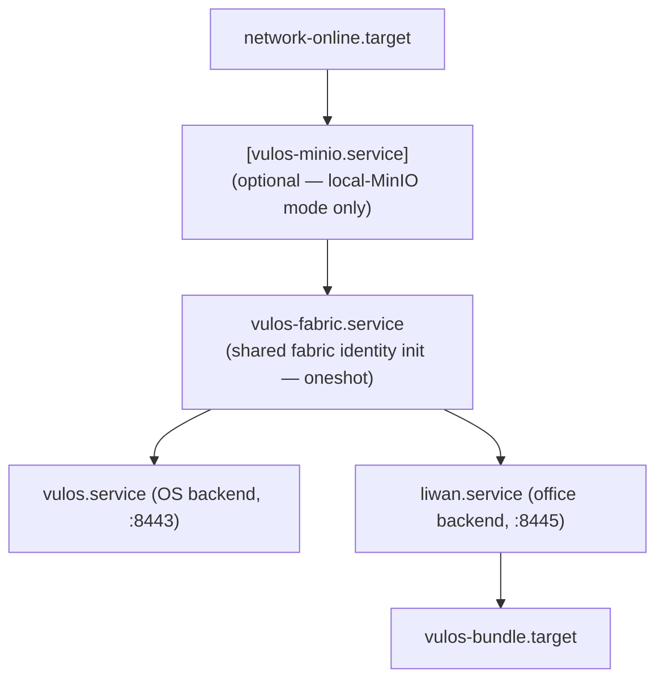

# Liwan — 安装指南

本文档介绍如何安装并运行 `liwan`，既可以与 Vulos OS 同机部署（推荐的单机部署方式），也可以作为独立服务运行。

端到端的部署流程（Docker、从源码构建、升级）请参见 [`DEPLOY.md`](DEPLOY.md)。

---

## 同机部署（推荐）

受支持的“简易路径”是**同机捆绑包**：一台机器同时运行 Vulos OS 和 liwan，共享**同一个 S3 兼容的存储桶端点**
（默认使用 Tigris，需提供你自己的 Tigris 凭据；也可通过 OS 侧的存储选择器选择启用本地 MinIO）。
两个服务共享同一套 CRDT/点对点网络结构和同一个身份体系。

### 使用捆绑安装程序（标准命令）

`vulos` 仓库提供了一个元捆绑安装程序（`BUNDLE-01`，
[`scripts/install-vulos.sh`](https://github.com/vul-os/vulos/blob/main/scripts/install-vulos.sh)），
它会部署 OS 与办公套件、写入其 systemd 单元，并初始化共享存储配置。请勿在此重复实现，直接调用即可：

```sh
# Tigris-backed (default)
curl -fsSL https://get.vulos.org | sudo bash

# Local-MinIO-backed (BYO single-box)
curl -fsSL https://get.vulos.org | sudo bash -s -- --storage=minio
```

安装完成后：

```sh
sudo systemctl enable --now vulos-bundle.target
```

完整的捆绑包参考文档见 https://github.com/vul-os/vulos/blob/dev/docs/SELF-HOST-BUNDLE.md。

### 共享存储配置（环境变量）

OS 侧的存储模式选择器（`STORE-LOCAL-01`，
`vulos/backend/internal/storagemode/`）会写入一个共享的环境变量文件
（由 `vulos.service` 和 `liwan.service` 读取），其中包含以下变量。Liwan 在启动时读取这些变量，
并将其传入 [`OfficeBackendConfig`](../backend/storage/backendconfig.go)：

| 变量                    | 用途                                                                    |
|-------------------------|-------------------------------------------------------------------------|
| `VULOS_STORAGE_MODE`    | `central-tigris`（默认）或 `local-minio-sync`（自带单机 MinIO）         |
| `VULOS_MINIO_ENDPOINT`  | S3 端点 URL（仅当模式为 `local-minio-sync` 时使用）                     |
| `VULOS_MINIO_REGION`    | 区域标签（默认为 `auto`）                                               |
| `VULOS_MINIO_BUCKET`    | OS 与办公套件共享的存储桶（例如 `vulos-bundle`）                        |
| `VULOS_MINIO_CREDS_REF` | 凭据文件路径（例如 `/var/lib/vulos/minio/.minio_secret`）               |

在 `central-tigris` 模式下，办公套件会通过 `OfficeTigrisDefaults()` 回退到标准的 Tigris 环境变量
（`TIGRIS_ENDPOINT`、`TIGRIS_REGION`、`TIGRIS_ACCESS_KEY_ID`、`TIGRIS_SECRET_ACCESS_KEY`）。

### systemd 单元顺序

捆绑安装程序会写入以下单元——`liwan` 会在 **`vulos.service`** 和共享的 **`vulos-fabric.service`**（一次性 oneshot 任务，负责共享身份/网络结构的初始化）**之后**启动。两者都由 `vulos-bundle.target`（全部启动的标志目标）拉起。



办公套件相关的顺序（来自 `vulos` 仓库中的
[`scripts/diwan.service`](https://github.com/vul-os/vulos/blob/main/scripts/diwan.service)）：

```ini
[Unit]
After=network-online.target vulos-fabric.service vulos.service
Requires=vulos-fabric.service

[Install]
WantedBy=multi-user.target vulos-bundle.target
```

Liwan 被刻意设置为在 `vulos.service` 和 fabric oneshot 任务**之后**启动，以确保办公套件在打开存储后端之前，
共享的存储桶凭据和 fabric 身份已经就绪。捆绑目标
（[`scripts/vulos-bundle.target`](https://github.com/vul-os/vulos/blob/main/scripts/vulos-bundle.target)）
同时通过 `Wants=` 和 `After=` 关联这两个服务，因此 `systemctl start vulos-bundle.target` 可以原子化地启动整个套件（`systemctl stop` 则会整体关停）。

---

## 独立办公套件

如果你只需要办公套件（不需要 Vulos OS），可以直接运行办公套件，并自行通过
[`OfficeBackendConfig`](../backend/storage/backendconfig.go) 注入存储端点——liwan 内部没有端点选择逻辑，它只接收你提供的配置。
相关的存储/同机部署说明参见 [`ROADMAP.md`](../ROADMAP.md)。

支持的两种形式如下：

### Tigris（托管的默认选项）

```go
cfg := storage.OfficeTigrisDefaults()
cfg.Bucket = "my-office-bucket"
cfg.Prefix = "acct-1234"
client, err := storage.NewOfficeS3Client(cfg)
```

会从环境变量中读取 `TIGRIS_ENDPOINT`、`TIGRIS_REGION`、`TIGRIS_ACCESS_KEY_ID`、`TIGRIS_SECRET_ACCESS_KEY`
（默认为 `https://fly.storage.tigris.dev`，区域为 `auto`）。

### MinIO（自行托管）

```go
cfg := storage.OfficeBackendConfig{
    Kind:            storage.OfficeBEKindMinIO,
    Endpoint:        "https://minio.example.lan",   // must be https://
    Region:          "auto",
    Bucket:          "liwan",                 // required
    Prefix:          "acct-1234",
    AccessKeyID:     "…",
    SecretAccessKey: "…",
}
client, err := storage.NewOfficeS3Client(cfg)
```

两种后端都使用相同的 S3 兼容接口（纯 Go 实现的 SigV4，无需 CGO）。
Liwan 会在启动时记录所解析出的端点。

关于运行时配置文件和 Docker 快速开始，参见 [`DEPLOY.md`](DEPLOY.md)。
